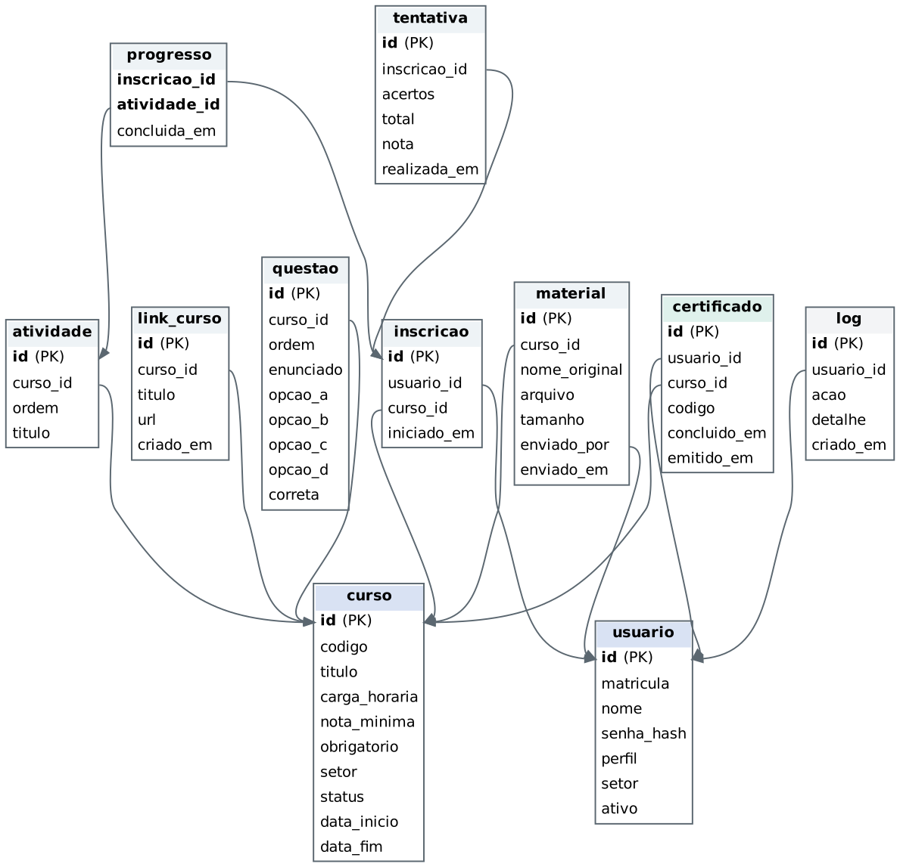

# Banco de dados: onde fica, como ver e o que tem dentro

## 1. Onde o banco fica

O sistema usa o **SQLite**: o banco inteiro é **um único arquivo** dentro da pasta do projeto.

| O quê | Onde |
|---|---|
| Banco de dados | `instance/portal.db` |
| Arquivos anexados aos cursos (PDF, Word...) | `instance/uploads/` |

A pasta `instance/` é criada sozinha na primeira vez que você roda `python seed.py` ou
`flask --app app run`. Ela **não vai para o GitHub** (está no `.gitignore`), então cada pessoa da
equipe tem o seu próprio banco, com os mesmos dados de demonstração.

> Para ver o caminho exato no seu computador, entre como administrador e abra
> **Administração → Ver o banco de dados**: o endereço completo aparece no topo da tela.

## 2. Como ver o que tem no banco

Há três jeitos, do mais simples ao mais completo.

### 2.1 Pela própria tela (somente leitura)

Entre como **9001 / admin123**, abra **Administração → Ver o banco de dados**. Você vê todas as
tabelas, quantos registros cada uma tem e, ao clicar no nome, as linhas (20 por página). Não dá
para alterar nada por ali, e a senha (hash) aparece como `(oculto)`.

### 2.2 Com um programa gráfico (recomendado para estudar)

Instale o **DB Browser for SQLite** (gratuito, sqlitebrowser.org), abra o arquivo
`instance/portal.db` e use a aba **Navegar dados**. Dá para ver as tabelas, filtrar e rodar
consultas. **Feche o programa antes de rodar o sistema** ou use "Abrir somente leitura", para o
arquivo não ficar travado.

No VS Code, a extensão **SQLite Viewer** também abre o arquivo com um clique.

### 2.3 Pelo terminal, com Python (já instalado)

```bash
python -c "import sqlite3; c=sqlite3.connect('instance/portal.db'); print(c.execute('SELECT matricula, nome, perfil FROM usuario').fetchall())"
```

## 3. Como as tabelas se relacionam



Como ler o diagrama: cada caixa é uma tabela; uma seta liga a coluna que **guarda o número** de
outro registro (por exemplo, `inscricao.usuario_id`) à tabela de onde esse número vem
(`usuario`). **PK** é a chave primária: o número que identifica cada linha.

Em palavras:

- Um **curso** tem várias **atividades**, **questões**, **materiais** e **links**.
- Um **usuário** que inicia um curso gera uma **inscrição** (uma por usuário e curso).
- A inscrição guarda o **progresso** (atividades concluídas) e as **tentativas** de avaliação (no máximo 3).
- Quem é aprovado pode ter um **certificado** (um por usuário e curso, com código único).
- A tabela **log** registra os eventos do sistema.

## 4. Regras que o próprio banco garante

| Regra | Como o banco impede o erro |
|---|---|
| Matrícula e código do curso não se repetem | `UNIQUE` em `usuario.matricula` e `curso.codigo` |
| Um colaborador não inicia o mesmo curso duas vezes | `UNIQUE(usuario_id, curso_id)` em `inscricao` |
| Um certificado por colaborador e curso, com código único | `UNIQUE(usuario_id, curso_id)` e `UNIQUE(codigo)` em `certificado` |
| Nota mínima do curso entre 70 e 100 (RN-01) | `CHECK` em `curso.nota_minima` |
| Perfil só pode ser colaborador ou administrador | `CHECK` em `usuario.perfil` |
| Conta só pode estar ativa (1) ou desativada (0) | `CHECK` em `usuario.ativo` |
| Situação do curso só ativo, suspenso ou arquivado | `CHECK` em `curso.status` |
| Nota de 0 a 100 | `CHECK` em `tentativa.nota` |
| Não existe registro apontando para algo que não existe | Chaves estrangeiras ligadas (`PRAGMA foreign_keys = ON`) |

## 5. Dicionário das tabelas

### `atividade`

As atividades de cada curso (o colaborador as marca como concluídas).

| Coluna | Tipo | Observação |
|---|---|---|
| `id` | INTEGER | chave primária |
| `curso_id` | INTEGER | aponta para `curso`; obrigatória |
| `ordem` | INTEGER | obrigatória |
| `titulo` | TEXT | obrigatória |

### `certificado`

Certificados emitidos, com código único (um por colaborador e curso).

| Coluna | Tipo | Observação |
|---|---|---|
| `id` | INTEGER | chave primária |
| `usuario_id` | INTEGER | aponta para `usuario`; obrigatória |
| `curso_id` | INTEGER | aponta para `curso`; obrigatória |
| `codigo` | TEXT | obrigatória |
| `concluido_em` | TEXT | obrigatória |
| `emitido_em` | TEXT | obrigatória |

### `curso`

Cursos oferecidos, com nota mínima, período e situação (ativo, suspenso ou arquivado).

| Coluna | Tipo | Observação |
|---|---|---|
| `id` | INTEGER | chave primária |
| `codigo` | TEXT | obrigatória |
| `titulo` | TEXT | obrigatória |
| `carga_horaria` | INTEGER | obrigatória |
| `nota_minima` | INTEGER | obrigatória |
| `obrigatorio` | INTEGER | obrigatória |
| `setor` | TEXT | - |
| `status` | TEXT | obrigatória |
| `data_inicio` | TEXT | obrigatória |
| `data_fim` | TEXT | obrigatória |

### `inscricao`

Registro de que um colaborador iniciou um curso (uma por colaborador e curso).

| Coluna | Tipo | Observação |
|---|---|---|
| `id` | INTEGER | chave primária |
| `usuario_id` | INTEGER | aponta para `usuario`; obrigatória |
| `curso_id` | INTEGER | aponta para `curso`; obrigatória |
| `iniciado_em` | TEXT | obrigatória |

### `link_curso`

Links de vídeo indicados em um curso.

| Coluna | Tipo | Observação |
|---|---|---|
| `id` | INTEGER | chave primária |
| `curso_id` | INTEGER | aponta para `curso`; obrigatória |
| `titulo` | TEXT | obrigatória |
| `url` | TEXT | obrigatória |
| `criado_em` | TEXT | obrigatória |

### `log`

Trilha de auditoria: quem fez o quê e quando (nunca guarda senha).

| Coluna | Tipo | Observação |
|---|---|---|
| `id` | INTEGER | chave primária |
| `usuario_id` | INTEGER | aponta para `usuario` |
| `acao` | TEXT | obrigatória |
| `detalhe` | TEXT | - |
| `criado_em` | TEXT | obrigatória |

### `material`

Arquivos anexados a um curso (o arquivo fica em instance/uploads).

| Coluna | Tipo | Observação |
|---|---|---|
| `id` | INTEGER | chave primária |
| `curso_id` | INTEGER | aponta para `curso`; obrigatória |
| `nome_original` | TEXT | obrigatória |
| `arquivo` | TEXT | obrigatória |
| `tamanho` | INTEGER | obrigatória |
| `enviado_por` | INTEGER | aponta para `usuario` |
| `enviado_em` | TEXT | obrigatória |

### `progresso`

Quais atividades cada inscrição já concluiu.

| Coluna | Tipo | Observação |
|---|---|---|
| `inscricao_id` | INTEGER | parte da chave primária; aponta para `inscricao` |
| `atividade_id` | INTEGER | parte da chave primária; aponta para `atividade` |
| `concluida_em` | TEXT | obrigatória |

### `questao`

Perguntas da avaliação do curso, com as 4 respostas e a letra certa.

| Coluna | Tipo | Observação |
|---|---|---|
| `id` | INTEGER | chave primária |
| `curso_id` | INTEGER | aponta para `curso`; obrigatória |
| `ordem` | INTEGER | obrigatória |
| `enunciado` | TEXT | obrigatória |
| `opcao_a` | TEXT | obrigatória |
| `opcao_b` | TEXT | obrigatória |
| `opcao_c` | TEXT | obrigatória |
| `opcao_d` | TEXT | obrigatória |
| `correta` | TEXT | obrigatória |

### `tentativa`

Cada avaliação feita: acertos, total e nota em percentual (no máximo 3 por inscrição).

| Coluna | Tipo | Observação |
|---|---|---|
| `id` | INTEGER | chave primária |
| `inscricao_id` | INTEGER | aponta para `inscricao`; obrigatória |
| `acertos` | INTEGER | obrigatória |
| `total` | INTEGER | obrigatória |
| `nota` | INTEGER | obrigatória |
| `realizada_em` | TEXT | obrigatória |

### `usuario`

Colaboradores e administradores (o RH é simulado por esta tabela). `ativo` = 0 é conta desativada: não entra, mas o histórico fica.

| Coluna | Tipo | Observação |
|---|---|---|
| `id` | INTEGER | chave primária |
| `matricula` | TEXT | obrigatória |
| `nome` | TEXT | obrigatória |
| `senha_hash` | TEXT | obrigatória; senha **criptografada** (hash), nunca em texto |
| `perfil` | TEXT | obrigatória |
| `setor` | TEXT | obrigatória |
| `ativo` | INTEGER | obrigatória; 1 = conta ativa, 0 = desativada |

## 6. Consultas de exemplo

Rode no DB Browser (aba **Executar SQL**). São todas só de leitura (`SELECT`).

**Quem são os usuários?** (a senha nunca é guardada em texto: só o hash)

```sql
SELECT matricula, nome, perfil, setor, ativo FROM usuario;
```

**Quais cursos existem e em que situação?**

```sql
SELECT codigo, titulo, nota_minima, status, data_inicio, data_fim FROM curso;
```

**Quem iniciou cada curso e quantas atividades já concluiu?**

```sql
SELECT u.nome, c.codigo,
       (SELECT COUNT(*) FROM progresso p WHERE p.inscricao_id = i.id) AS atividades_concluidas
FROM inscricao i
JOIN usuario u ON u.id = i.usuario_id
JOIN curso c ON c.id = i.curso_id;
```

**Notas de cada tentativa:**

```sql
SELECT u.nome, c.codigo, t.nota, t.realizada_em
FROM tentativa t
JOIN inscricao i ON i.id = t.inscricao_id
JOIN usuario u ON u.id = i.usuario_id
JOIN curso c ON c.id = i.curso_id
ORDER BY t.realizada_em;
```

**Certificados emitidos:**

```sql
SELECT u.nome, c.titulo, ce.codigo, ce.emitido_em
FROM certificado ce
JOIN usuario u ON u.id = ce.usuario_id
JOIN curso c ON c.id = ce.curso_id;
```

**Últimos 20 eventos:**

```sql
SELECT criado_em, acao, detalhe FROM log ORDER BY id DESC LIMIT 20;
```

## 7. Recomeçar do zero e fazer cópia

| Quero... | Faça |
|---|---|
| Voltar aos dados de demonstração | Feche o servidor, apague a pasta `instance/` e rode `python seed.py` |
| Guardar uma cópia | Copie `instance/portal.db` e a pasta `instance/uploads/` com o servidor parado |
| Levar o banco para outro computador | Copie o arquivo `portal.db` para a pasta `instance/` do outro projeto |

**Cuidado:** apagar `instance/` apaga também os arquivos anexados e todo o histórico (tentativas,
certificados, eventos). Os eventos servem de auditoria (CA-16), então não os apague sem necessidade.

## 8. Versões do banco: o que acontece ao atualizar

Quando uma versão nova do sistema acrescenta uma coluna, ele a cria sozinho na primeira execução e **não apaga nada**. Foi assim com `usuario.ativo`: contas que já existiam continuam ativas. O sistema só recusa subir se o banco for muito antigo (aí ele diz para apagar a pasta `instance`).

## 9. Limites do SQLite neste projeto

O SQLite é ótimo para o protótipo (não precisa instalar nada), mas **não** é o banco indicado para
muitos acessos ao mesmo tempo: o teste de 500 acessos (RNF-01) e a disponibilidade de 99,5%
(RNF-03) estão fora do escopo. Em produção, a proposta é trocar por um banco de servidor, como o
PostgreSQL (ver `docs/ci-cd.md`).
